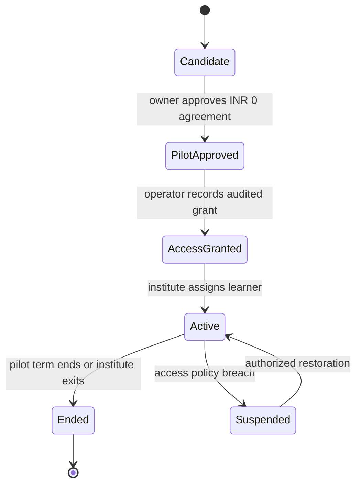

# Assisted institute pilot commercial contract

Effective decision date: 21 October 2026

## Pilot offer

The first pilot is a **zero-price, assisted institute evaluation** for the approved Class 7 Math and Science objective-exam scope. The pilot price is **INR 0**. No student, parent or teacher pays Nexora, no card or UPI details are collected, and no payment order, tax invoice, renewal or automatic charge is created.

The product owner owns the offer and institute admission. The institute administrator owns learner assignment. Platform operations owns any pilot entitlement or star grant and must use audited administrative controls. Such grants represent included pilot access and must not be labelled paid, purchased, refunded or settled.

The pilot term and cohort capacity are recorded in each design-partner agreement. Access ends at the recorded pilot end unless the product owner extends it in writing. Because consideration is zero, cancellation ends future access without a monetary refund. Existing submitted attempts and results remain available under the retention policy.

## Supported channels

| Channel | Pilot purchase path | Entitlement owner | State |
| --- | --- | --- | --- |
| Institute web | Assisted INR 0 agreement and audited access grant | Platform operations | Supported |
| Student web | Consumption of institute-assigned access only | Institute administrator | Purchasing disabled |
| Android/iOS student app | Consumption of institute-assigned access only | Institute administrator | Purchasing disabled |
| Shared content library | None | Academic/product owner | Sales deferred pending W05.04 |

`STUDENT_SELF_SERVICE_PURCHASES_ENABLED` remains false in pilot environments. The backend rejects direct star-pack and subscription order creation, and the web shows institute-managed access guidance. Native apps expose no purchase or external-payment route.

## First paid release

No paid offer is authorized by this decision. Before W06.02 begins, the founder and finance owner must approve a separate version of this contract containing an exact INR price, GST/tax and invoice owner, provider and merchant account, billing interval, renewal consent, cancellation timing, refund windows, entitlement start/end rules and support escalation. W06.02–W06.05 remain outside the pilot.

Native purchase behavior will be decided during W08 using the store rules current at submission time. The mobile app must not add a web checkout link or in-app purchase until that review and W06.05 approval are recorded.

## Commercial state diagram

There is no `pending payment`, `captured`, `refunded` or `renewed` state in the pilot contract.
